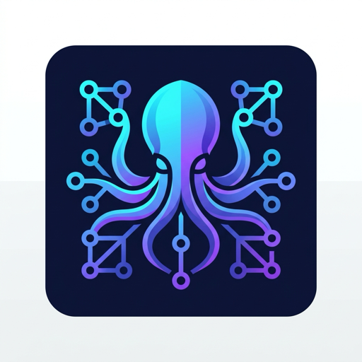

<p align="center">
  
</p>

<h1 align="center">Octo</h1>

<p align="center">
  <strong>Keep-It-Simple Distributed Multi-Agent GitHub Kanban Orchestrator</strong>
</p>

Uses **GitHub Issues, Labels, and Pull Requests** as the Single Source of Truth (SSOT) — zero external databases, zero external dependencies (pure Python 3 stdlib + `gh` CLI).

> **Octo only orchestrates.** Every thinking, goal-setting, planning, critique, coding, and review step is performed by declarative **Agents** defined in [`agents/`](agents/).

---

## ✨ How It Works

1. **Declarative Agents & Models (`agents/*.md`)**:
   - Each agent is a Markdown file with YAML frontmatter (`harness`, `provider`, `model`, `thinking`, `endpoint`, `read_only`) + its system prompt:
     - `agents/planner-explorer.md` — inspects the codebase (read-only) and produces a grounded context brief.
     - `agents/planner-architect.md` — sets explicit Goals/Non-Goals, designs the RFC, interfaces, edge cases, and Task DAG.
     - `agents/planner-critic.md` — audits the draft plan for gaps, file collisions, and weak verification.
     - `agents/worker.md` — implements one task inside an isolated `.worktrees/issue-<N>` worktree.
     - `agents/qa.md` — reviews PR diffs and test outputs independently.
   - Run `./bin/octo agents` at any time to see the exact pipeline, harnesses, and models configured.
   - Override any run on the fly with `--agent <name>`, `--profile <name>`, or `--model <model>`.

2. **Multi-Step Agent Planning Loop (`octo plan`)**:
   - Instead of a shallow single-shot prompt, Octo orchestrates:
     `Explorer` ➔ `Architect (Goals & Draft)` ➔ `Critic <-> Architect` refinement loop (`planning.rounds: 2` by default) ➔ **Master Epic Issue** (`status:awaiting-approval`) + `docs/plans/EPIC-<N>.md`.
   - Use `--rounds 1` (and optional `--no-explore`) for quick plans, or `--rounds 3` for deeper review.

3. **Epic-Qualified Tasks & DAG Dependencies (`octo approve <N>`)**:
   - Approving Epic `#5` spawns unambiguous, Epic-linked GitHub issues:
     `[E5-T1] ...`, `[E5-T2] ...` with label `epic:5` and a parent Epic breadcrumb — never colliding with `[E1-T1]` from another Epic.
   - Root tasks start as `status:ready`; downstream tasks start as `status:blocked` and automatically unlock as upstream dependencies merge.

4. **Multi-Harness & Multi-Node Ready**:
   - Built-in adapters for `claude`, `pi`, `aider`, `agy`, `custom`, and `mock` (for deterministic testing).
   - Keep private LAN endpoints, SSH hosts, and local model overrides out of git using `orchestrator.local.yaml` or `agents/*.local.md` (both gitignored).

---

## 📂 Repository Layout

```text
├── agents/                    # Declarative agent definitions (harness, model, system prompt)
│   ├── planner-explorer.md
│   ├── planner-architect.md
│   ├── planner-critic.md
│   ├── worker.md
│   └── qa.md
├── bin/octo                   # Zero-dependency CLI entry point
├── orchestrator/              # Core Python stdlib modules
│   ├── config.py              # Config + local override + agent loader + protocol parser
│   ├── dag_planner.py         # Multi-agent planning loop, Epic gate, DAG unblocker
│   ├── harness_runner.py      # Adapters for claude, pi, aider, agy, custom, mock
│   ├── github_bus.py          # GitHub CLI (`gh`) transport & atomic lease locks
│   ├── worker_daemon.py       # Isolated Git worktree runner & lease heartbeat/reaper
│   ├── qa_auditor.py          # Verification runner & independent QA reviewer
│   ├── swarm_board.py         # GitHub-hosted Swarm message board
│   ├── overlap_detector.py    # AST import & file collision radar
│   ├── c2c_coordinator.py     # Coordinator-to-Coordinator negotiation
│   └── cluster_ssh.py         # Optional SSH remote worker manager
├── orchestrator.yaml          # Public-safe default configuration
├── AGENTS.md                  # Always-on repository protocol rules
└── tests/                     # Sandboxed unit & integration tests
```

---

## 🚀 Quick Start

```bash
# 1. Prerequisites: Python 3.10+, git, GitHub CLI (`gh auth login`), and at least one coding CLI (e.g. claude, pi, aider)

# 2. Bootstrap folders (`docs/inputs/`, `docs/plans/`, `agents/`), GitHub Kanban labels & Swarm Board
./bin/octo init

# 3. Inspect configured agents, models, and pipeline
./bin/octo agents

# 4. (Optional) Drop project requirement docs in `docs/inputs/` and run multi-agent planning
./bin/octo plan "Add JWT authentication middleware with tests"
# Or pass explicit docs, model, or refinement rounds:
./bin/octo plan "Add JWT auth" --docs docs/inputs/spec.md --model opus --rounds 3

# 5. Phase 2: Approve Epic #1 -> spawns [E1-T1], [E1-T2]... with label `epic:1`
./bin/octo approve 1

# 6. Run a Worker (claims a `status:ready` task in an isolated worktree & opens a PR)
./bin/octo worker --once

# 7. Run QA + DAG Reconciliation (reviews PRs, auto-merges on PASS, unblocks downstream tasks)
./bin/octo orchestrate --once

# 8. Check live Kanban status & overlap radar
./bin/octo status
./bin/octo overlap
```

---

## 🔧 Customizing Models & Private Nodes Safely

Never commit private IPs, SSH usernames, or API keys to `orchestrator.yaml`.
Instead, create a gitignored `orchestrator.local.yaml` (or `agents/<name>.local.md`):

```yaml
# orchestrator.local.yaml (gitignored)
agents:
  planner-architect:
    harness: pi
    provider: local
    model: qwen2.5-coder:32b
    endpoint: http://localhost:11434/v1
    thinking: high

nodes:
  gpu-worker-1:
    host: gpu-worker-1
    ssh_user: myuser
    roles: ["worker", "qa"]
    default_profile: pi-local
    workdir: ~/workspaces/my-project
```

---

## 🧪 Running Tests

```bash
python3 -m unittest discover -s tests -v
```
